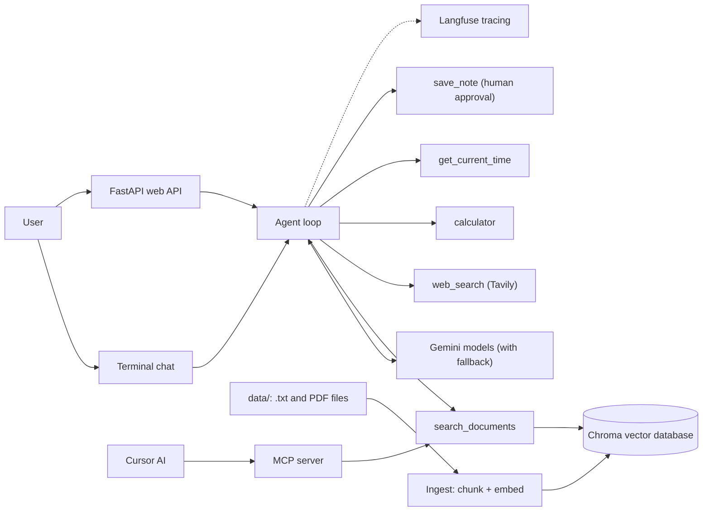

# DocPilot

An agentic RAG assistant that answers questions from your own documents, with citations. Built from scratch in Python, without an agent framework, to understand every layer of an AI agent.

## What it does

- Answers questions from your documents (.txt and PDF), citing the file and page
- Searches the web when your documents don't have the answer
- Uses tools for exact answers: a calculator and a timezone-aware clock
- Saves notes, and asks a human before overwriting anything
- Asks a clarifying question when a question could refer to more than one document
- Runs as a terminal chat, a web API, a Docker container, and an MCP server for Cursor

## Architecture



## How it works

1. **Ingest** (`rag.py`): documents are split into chunks (paragraphs for text files, 100-word chunks with 20-word overlap for PDFs), embedded with Gemini, and stored in Chroma with file and page metadata.
2. **Agent loop** (`agent.py`): Gemini decides which tool to use; my code runs it and sends the result back, repeating until it can answer. The loop has a step limit.
3. **Grounding**: a system prompt with 12 rules makes the agent answer only from retrieved sources, cite them, check documents before the web, and say when it doesn't know.

## Reliability and safety

| Problem | Solution |
| --- | --- |
| Busy servers (503) and rate limits (429) | Retries with exponential backoff |
| A model down or out of quota | Automatic fallback to backup models, with a circuit breaker |
| Requests that hang | 30-second timeout |
| Prompt injection in documents | Tested with planted attacks; rules, "data only" labels, and human approval in code |
| Path traversal in note names | File names are sanitised |
| Public API abuse | API key required on `/ask` |

## Results

| Measurement | Result |
| --- | --- |
| Eval suite (7 cases, incl. prompt injection and hallucination tests) | [X] / 7 passed |
| Slowest question before reliability fixes | 4 min 40 s |
| Same question after circuit breaker + timeout | 1 min 07 s |
| Tokens per tool-using question | about 3,400 input, 50 to 70 output |

## Tech stack

Python, Google Gemini API (chat and embeddings), Chroma, pypdf, Tavily, Langfuse, FastAPI, Docker, MCP.

## Run it yourself

```bash
python -m venv .venv
.venv\Scripts\activate          # Mac/Linux: source .venv/bin/activate
pip install -r requirements.txt
copy .env.example .env          # then fill in your keys
python rag.py                   # build the document database
python agent.py                 # chat in the terminal
```

Other ways to run it:

- Web API: `uvicorn api:app --reload`, then open http://127.0.0.1:8000/docs
- Docker: `docker build -t docpilot .` then `docker run -p 8000:8000 --env-file .env docpilot`
- Evals: `python evals.py`
- MCP: point your MCP client (for example Cursor) at `mcp_server.py` using your venv's Python

## What I learned

[Write 3 to 5 sentences in your own words. For example: the hardest bug you fixed, what surprised you about prompt injection, why you separated soft and hard rules, or what the traces showed you.]

## Next steps

- Hybrid search (keyword + embeddings) and reranking
- A SQL database tool
- A web interface with streaming answers